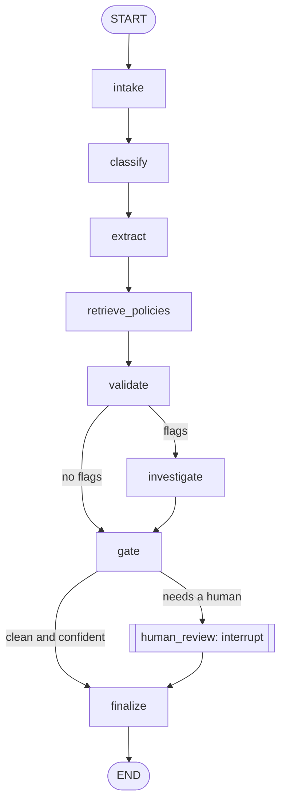

# WATHQA (وثيقة)

An AI agent that reviews invoices and expense claims against company policies, and flags the ones that need a human decision.

Built with LangGraph, LangChain, FastAPI and Pydantic. The LLM is Groq.

## What it does

1. Reads a document (`.txt`, `.md`, or a `.pdf` with copyable text).
2. Classifies it: invoice, expense claim, receipt, or unknown.
3. Extracts vendor, date, currency, category, net, VAT and total into a Pydantic schema.
4. Retrieves the relevant company policies.
5. Runs deterministic checks: missing fields, category spending limits, VAT (14%), and net + VAT = total.
6. If something is flagged, an investigation step uses tools (VAT calculator, line-item sum, policy search) to look closer.
7. Decides: auto-approve, or pause for a human to approve or reject.

## Review graph



A review goes to a human when any of these is true:

- the checks raised flags
- extraction confidence is below 0.7
- the amount is above the auto-approve limit (2000)

The pause uses LangGraph `interrupt()` with a checkpointer, so the review can be resumed later with the human's answer. Checkpoints are kept in memory.

## Project structure

```text
src/wathiqa_agent/
  config.py     settings from environment variables
  schemas.py    Pydantic data contracts
  state.py      graph state
  llm.py        Groq chat model factory
  tools.py      LangChain tools: parse_document, vat_calculator, sum_line_items, policy_search
  policies.py   policy list and keyword retriever
  nodes.py      graph nodes and routing
  graph.py      graph wiring, start_review, resume_review
  evaluate.py   evaluation script
  api.py        FastAPI app
  __main__.py   command line: run, eval, serve
frontend/
  wathiqa-ui.html   single-file web UI
data/sample_docs/   four sample documents
test/               pytest tests
```

## Setup

Requires Python 3.12 and [uv](https://docs.astral.sh/uv/).

```bash
git clone https://github.com/elde8idy/wathiqa--agent.git
cd wathiqa--agent
uv sync
```

Create a `.env` file in the project root:

```env
WATHIQA_GROQ_API_KEY=your_groq_api_key
```

You can get a free key from the Groq console. Every setting uses the `WATHIQA_` prefix, including the key.

Optional settings and their defaults:

| Variable | Default |
|---|---|
| `WATHIQA_LLM_PROVIDER` | `groq` (the only supported value) |
| `WATHIQA_MODEL` | `openai/gpt-oss-120b` |
| `WATHIQA_AUTO_APPROVE_LIMIT` | `2000` |
| `WATHIQA_CONFIDENCE_THRESHOLD` | `0.7` |
| `WATHIQA_MAX_INVESTIGATION_STEPS` | `3` |
| `WATHIQA_VAT_RATE` | `0.14` |

## Run from the command line

```bash
uv run python -m wathiqa_agent run --file data/sample_docs/invoice_clean.txt
uv run python -m wathiqa_agent run --file data/sample_docs/invoice_vat_mismatch.txt
uv run python -m wathiqa_agent run --file data/sample_docs/expense_over_limit.txt
uv run python -m wathiqa_agent run --file data/sample_docs/invoice_missing_fields.txt
```

When a review needs a human, the CLI prints the flags and the investigation, then asks `approve` or `reject`. Add `--yes` to answer approve automatically. You can also pass text directly with `--text "..."`.

## Run the API and the web UI

```bash
uv run python -m wathiqa_agent serve --port 8000
```

Swagger docs: http://127.0.0.1:8000/docs

| Method | Path | Purpose |
|---|---|---|
| GET | `/health` | Status and LLM provider |
| POST | `/reviews` | Start a review with `document_text` or `document_path` |
| POST | `/reviews/{thread_id}/resume` | Send `{"feedback": "approve"}` or `"reject"` |

```bash
curl -X POST http://127.0.0.1:8000/reviews \
  -H "Content-Type: application/json" \
  -d '{"document_path": "data/sample_docs/invoice_vat_mismatch.txt"}'
```

If the review needs a human, the response has `status: needs_review` and a `thread_id`. Resume it:

```bash
curl -X POST http://127.0.0.1:8000/reviews/<thread_id>/resume \
  -H "Content-Type: application/json" \
  -d '{"feedback": "approve"}'
```

For the web UI, start the server, then open `frontend/wathiqa-ui.html` in your browser. It talks to `http://127.0.0.1:8000` by default (editable in the page).

## Tests

```bash
uv run pytest -q
```

The tests call the real Groq model, so they need the API key in `.env`.

## Limitations

- Text only. There is no OCR, so scanned images and photos of receipts are not supported.
- Policies are a list in `policies.py`, searched by keyword overlap (no embeddings).
- Review state is stored in memory and is lost when the server restarts.
- Runs one document at a time. There is no batch mode.
- No authentication on the API.
- Groq is the only LLM provider.
