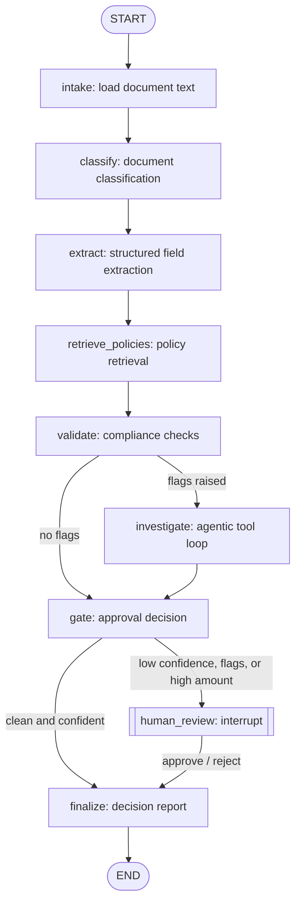

# WATHQA (وثيقة) — Agentic Expense Document Review

WATHQA is an agentic expense document-review system built with **LangGraph** and **LangChain**.

It processes expense documents (invoices, expense claims, and receipts), extracts structured information, checks documents against company expense policies, investigates suspicious cases using tools, and pauses for **human approval** whenever a document requires manual review.

The system supports an offline mode with a deterministic mock LLM provider, requiring zero API keys for local development and testing. It can also be configured to use **Groq (free tier)** or a fully local **Ollama** model by changing environment variables.

## Architecture



## Nodes and Responsibilities

| Node | Description |
|---|---|
| `intake` | Loads document text from supported files (`.txt`, `.md`, and `.pdf`) using the document parser. |
| `classify` | Classifies the document as `invoice`, `expense_claim`, `receipt`, or `unknown`. |
| `extract` | Extracts vendor, amounts, currency, date, and category into a Pydantic schema. A completeness score is used as extraction confidence. |
| `retrieve_policies` | Retrieves potentially relevant policies using dependency-free IDF keyword retrieval. |
| `validate` | Performs deterministic compliance checks, including required fields, spending limits, VAT recomputation (14%), gross-total consistency, and non-reimbursable categories. |
| `investigate` | Runs an agentic tool-calling loop using LangChain tools such as `vat_calculator`, `sum_line_items`, and `policy_search`. |
| `gate` | Routes documents to human review when flags exist, confidence is low, or the amount exceeds the auto-approval limit. |
| `human_review` | Uses LangGraph `interrupt()` to pause the graph until a human submits an `approve` or `reject` decision. |
| `finalize` | Generates a Markdown decision report containing the review result, policy information, and investigation log. |

## Repository Structure

```text
wathiqa-agent/
├── src/
│   └── wathiqa_agent/
│       ├── __init__.py
│       ├── config.py       # Environment-variable settings
│       ├── schemas.py      # Pydantic data contracts
│       ├── state.py        # LangGraph state definitions
│       ├── llm.py          # Provider factory and mock LLM
│       ├── tools.py        # LangChain tools
│       ├── policies.py     # Policy corpus and keyword retrieval
│       ├── nodes.py        # Graph nodes and routing functions
│       ├── graph.py        # StateGraph wiring and start/resume helpers
│       ├── evaluate.py     # Evaluation harness
│       ├── api.py          # FastAPI application
│       └── __main__.py     # CLI commands: run / eval / serve
├── data/
│   ├── sample_docs/        # Sample expense documents
│   └── gold/
│       └── labels.json
├── test/                   # Pytest test suite
├── .env.example
├── pyproject.toml
└── README.md
```

## Setup

The project uses **Python 3.12** and `uv` for dependency and environment management.

Install dependencies:

```bash
uv sync
```

Create your environment file from the example:

**Windows PowerShell:**
```powershell
Copy-Item .env.example .env
```

**Linux / macOS:**
```bash
cp .env.example .env
```

The default configuration uses the offline mock provider.

## LLM Providers

### Offline Mock Provider

The default provider is deterministic and does not require an API key.

It is useful for:
- Local development.
- Automated testing.
- Reproducible demonstrations.

### Groq (Free Tier)

Configure your `.env` file:

```env
WATHQA_LLM_PROVIDER=groq
GROQ_API_KEY=your_groq_api_key
WATHQA_MODEL=llama-3.3-70b-versatile
```

Install the provider integration:

```bash
uv add langchain-groq
```

### Ollama (Fully Local)

Pull a local model:

```bash
ollama pull qwen2.5:7b
```

Configure `.env`:

```env
WATHQA_LLM_PROVIDER=ollama
WATHQA_MODEL=qwen2.5:7b
```

Install the provider integration:

```bash
uv add langchain-ollama
```

## CLI Demo

Run the following commands from the project root.

### 1. Clean Invoice — Auto Approval

```bash
uv run python -m wathiqa_agent run --file data/sample_docs/invoice_clean.txt
```

Expected behavior: the document is processed and automatically approved if all checks pass.

### 2. VAT Mismatch — Human Review

```bash
uv run python -m wathiqa_agent run --file data/sample_docs/invoice_vat_mismatch.txt
```

Expected behavior: the VAT discrepancy is detected, investigated, and routed for human review.

The reviewer can approve or reject the document when prompted.

### 3. Over-limit Expense

```bash
uv run python -m wathiqa_agent run --file data/sample_docs/expense_over_limit.txt
```

Expected behavior: the expense exceeds the applicable spending limit and requires manual review.

## Example Review Report

```text
# WATHQA Review Report

- Decision: auto_approved
- Document type: invoice
- Vendor: TechHub Software Ltd
- Date: 2026-10-02
- Category: software
- Net: 1000.0
- VAT: 140.0
- Total: 1140.0 EGP
- Extraction confidence: 1.0

## Policy checks
- all checks passed
```

## REST API

WATHQA provides a REST API built with **FastAPI**.

### Start the API Server

```bash
uv run python -m wathiqa_agent serve --port 8000
```

Open the interactive Swagger documentation:

[http://127.0.0.1:8000/docs](http://127.0.0.1:8000/docs)

### Available Endpoints

| Method | Endpoint | Description |
|---|---|---|
| GET | `/health` | Checks API health. |
| POST | `/reviews` | Creates a new document review. |
| POST | `/reviews/{thread_id}/resume` | Resumes a paused review after human feedback. |

### Create a Review

```bash
curl -X POST http://127.0.0.1:8000/reviews \
  -H "Content-Type: application/json" \
  -d '{"document_path": "data/sample_docs/invoice_vat_mismatch.txt"}'
```

A review requiring human intervention returns a response similar to:

```json
{
  "status": "needs_review",
  "thread_id": "...",
  "flags": ["vat_mismatch"]
}
```

### Resume a Review

```bash
curl -X POST http://127.0.0.1:8000/reviews/<thread_id>/resume \
  -H "Content-Type: application/json" \
  -d '{"feedback": "approve"}'
```

The response contains the final review status and decision report.

## Evaluation

Run the evaluation harness:

```bash
uv run python -m wathiqa_agent eval
```

The evaluation harness runs the graph against labelled sample documents and generates an `eval_report.json` file.

The evaluation metrics include:

- **doc_type_accuracy** — predicted versus expected document type.
- **field_accuracy** — extraction accuracy for vendor, amount, currency, date, and category.
- **routing_accuracy** — accuracy of auto-approval versus human-review routing.

The deterministic mock provider is designed to produce reproducible results on the labelled sample documents. Real LLM providers may produce different results, making the evaluation harness useful for comparing models and prompts.

## Tests

Run the complete test suite:

```bash
uv run pytest -q
```

Run a specific test file:

```bash
uv run pytest -v test/test_graph.py
```

The tests cover graph execution, validation, routing, and thread isolation, along with the API and other project components as corresponding tests are added.

The graph tests currently include scenarios for:

- Clean invoice auto-approval.
- VAT mismatch and investigation routing.
- Over-limit expense review.
- Missing required fields.
- Isolated threads for separate reviews.

## Limitations

- **Mock provider is not a real LLM.** It is a deterministic stand-in for development, testing, and demonstrations.
- **Prompt-based extraction.** The extractor relies on LLM-generated JSON and tolerant parsing rather than strict provider-native structured output.
- **Keyword-based policy retrieval.** The retriever uses token-overlap scoring rather than embeddings, making it simple and offline-friendly but less effective with paraphrased queries.
- **In-memory checkpoints.** Human-review threads are stored in process memory. A production deployment should use persistent checkpointing, such as PostgreSQL.
- **Limited policy corpus and sample documents.** The current dataset demonstrates the workflow but is not a replacement for a real company's finance policy database.

## Future Improvements

- Persistent checkpoint storage with PostgreSQL.
- More robust policy retrieval using embeddings and vector databases.
- Better extraction validation and error handling.
- Expanded evaluation datasets and test coverage.
- Authentication and authorization for API endpoints.
- Production deployment and monitoring.
